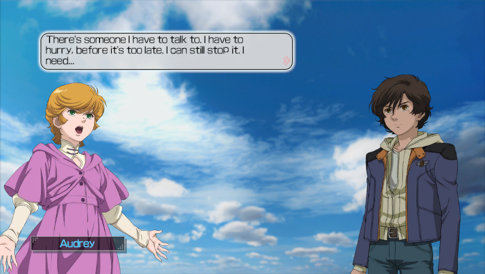
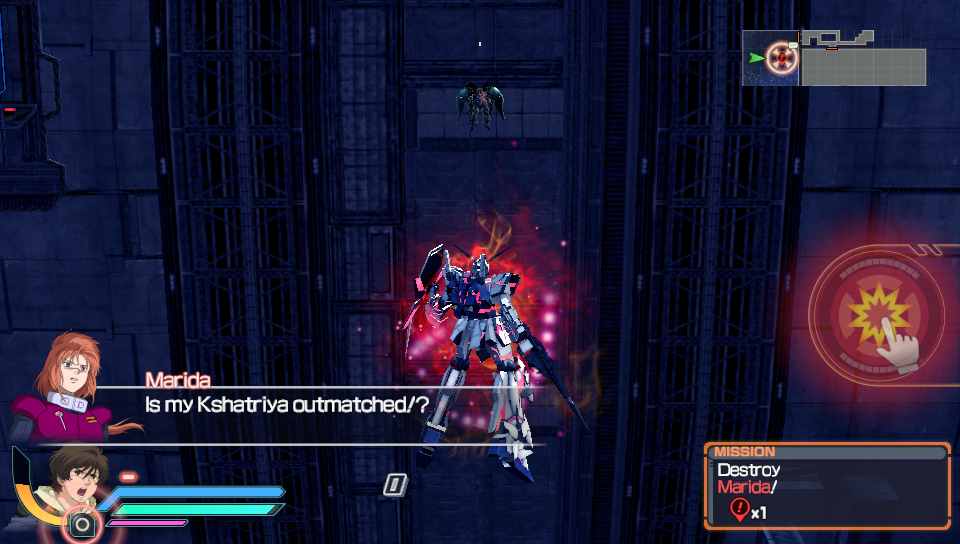
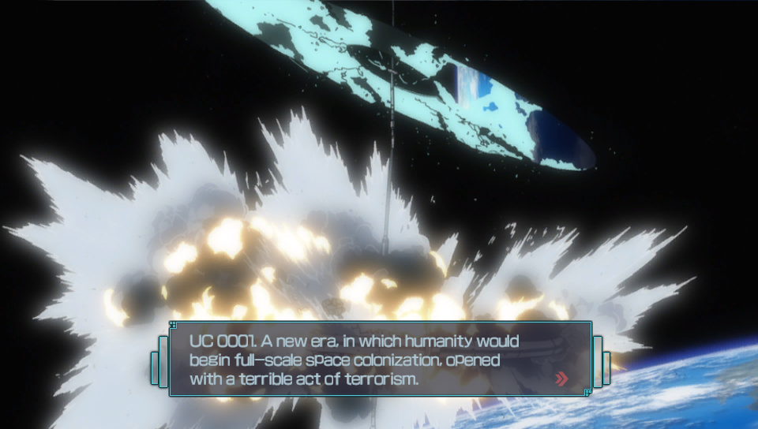
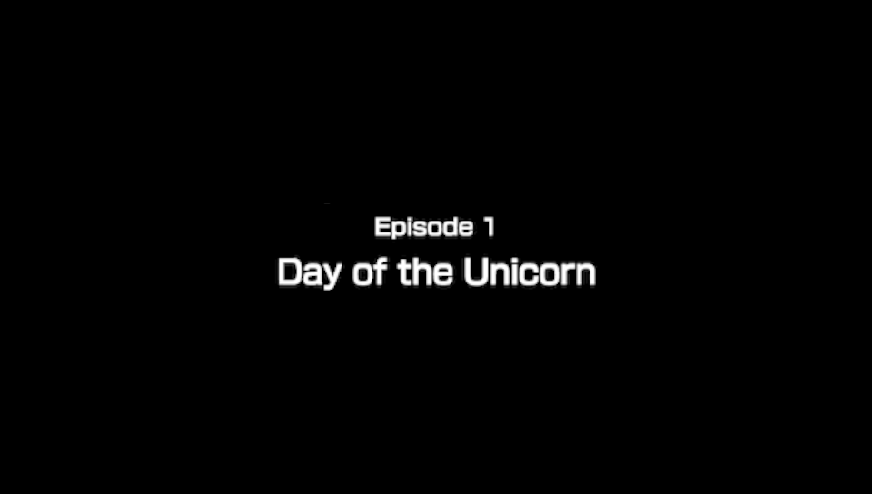
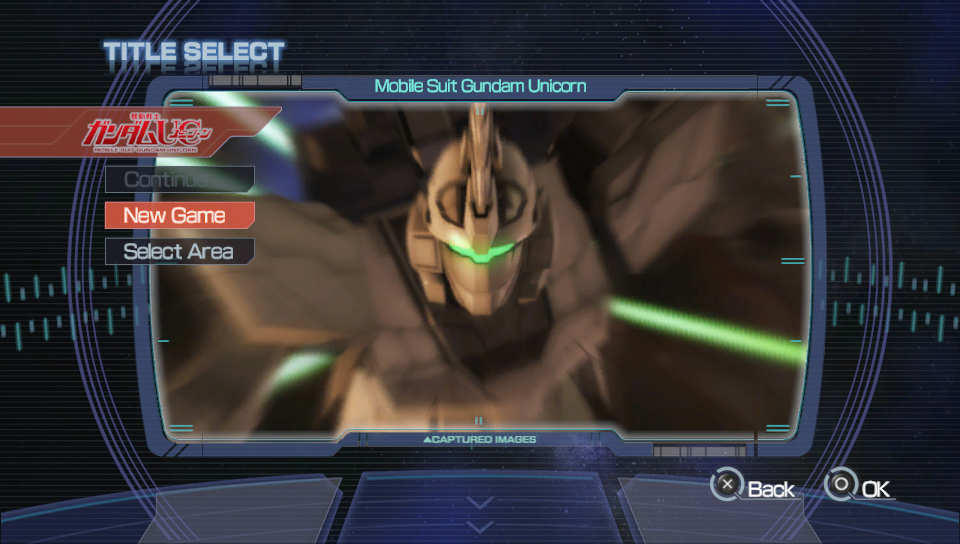
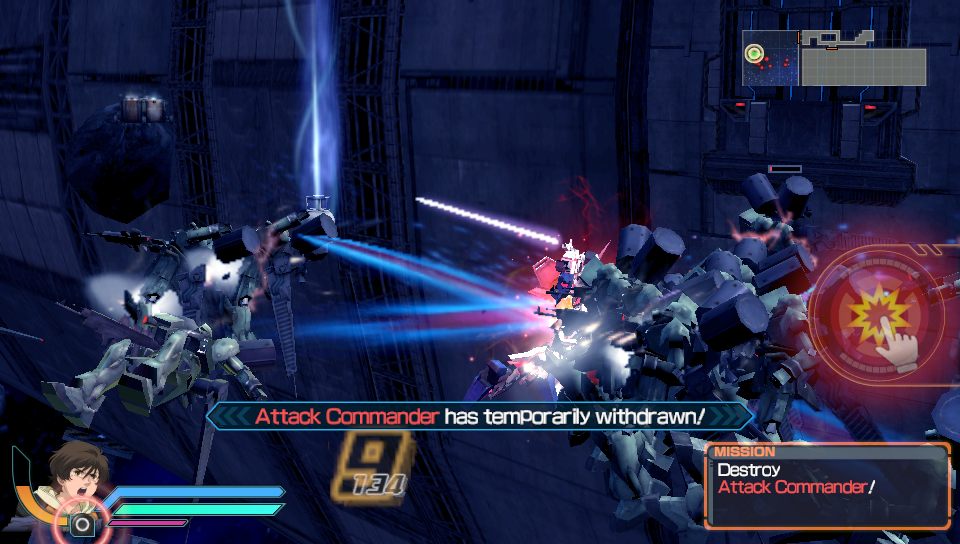
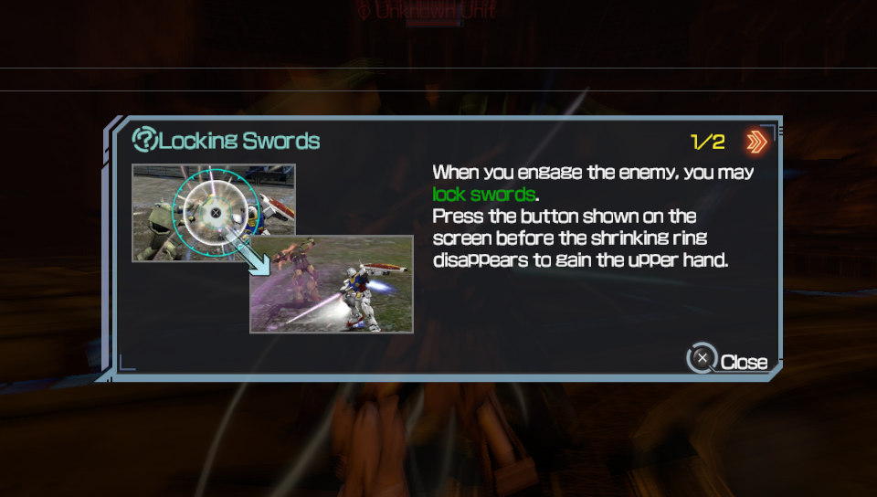
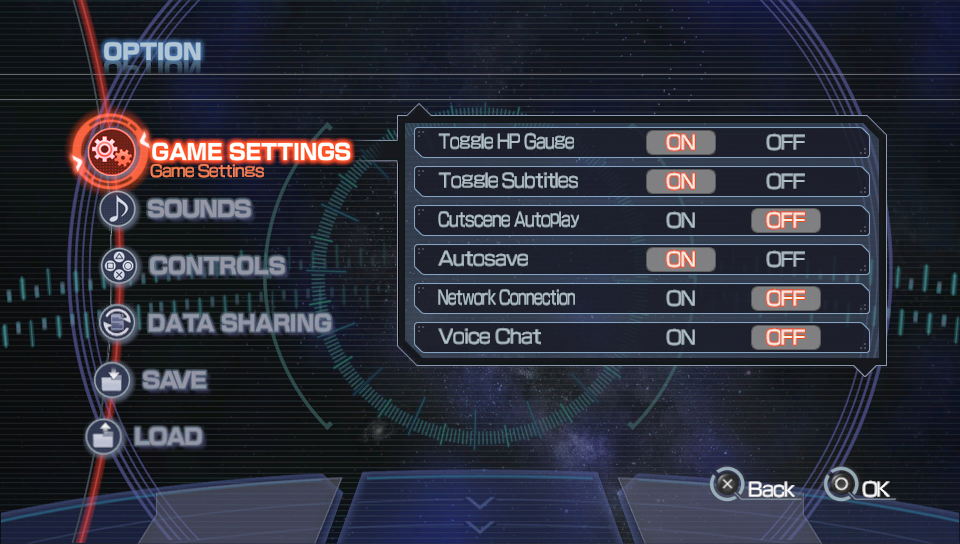
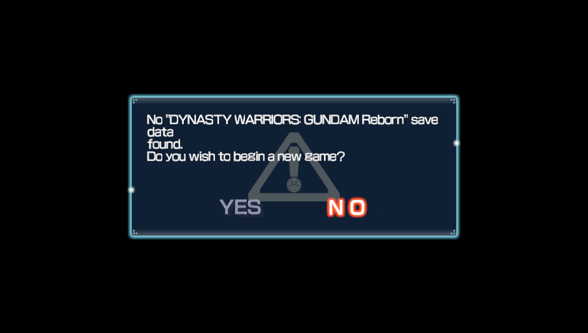

# Shin Gundam Musou (PS Vita) — English Patch

An English translation patch for **Shin Gundam Musou** (真・ガンダム無双, PS Vita, Japan only, `PCSG00278`).

The game was released in the West only on PS3, as *Dynasty Warriors: Gundam Reborn*. This project ports that
**official English localization** from the PS3 release onto the Japanese Vita release. Both versions run on the same
engine and use the same data layout.

> **Status: fully playable in English (v0.5.0; game versions 1.00 and 1.02).** Tested on a real
> PS Vita and in Vita3K.
>
> **Patch it in your browser with the [web patcher](https://irxd.github.io/shin-gundam-musou-en/)** or download the patch files
> from the [Releases](https://github.com/irxd/shin-gundam-musou-en/releases) page and use Delta Patcher. See [Installation](#installation).

<p align="center"> </p>

More screenshots: [Screenshots](#screenshots).

## Installation

The patch is a set of small **xdelta** files that you apply to files from **your own copy** of the game. No game
data is included.

### Quickest way (real Vita):
1. Get your decrypted `eboot.bin.elf`, `LINKDATA.B` and `LINKDATA.C` from the Vita (steps 1 and 2 below),
   and your decrypted DLC folder if you have DLC installed.
2. Open the **[web patcher](https://irxd.github.io/shin-gundam-musou-en/)**, choose the
   three files (and the DLC folder) and press **Patch**.
3. Copy the `rePatch` folder it gives you to `ux0:` on the Vita, and start the game.

### You need

- **The game:** Shin Gundam Musou, Japanese release **PCSG00278**, version **1.00** or **1.02** (the latest
  update). Check the version in the game's LiveArea or in `sce_sys/param.sfo`.
- **For a real Vita:**
  - A PS Vita on HENkaku/Ensō.
  - The **rePatch** plugin, installed under `*KERNEL` in `ux0:tai/config.txt` (or `ur0:tai/config.txt`).
  - **FAGDec**, to decrypt the game's `eboot.bin`.
  - **VitaShell**, to copy files between the Vita and your PC.
- **For [Vita3K](https://vita3k.org/):** the game installed in Vita3K. Its files are already decrypted.
- **To apply the patch**, one of:
  - the **[web patcher](https://irxd.github.io/shin-gundam-musou-en/)** in desktop Chrome or Edge (easiest), or
  - **[Delta Patcher](https://github.com/marco-calautti/DeltaPatcher/releases)** with the patch files from
    [Releases](https://github.com/irxd/shin-gundam-musou-en/releases). Other xdelta3 tools should also work, but Delta Patcher is the one that was tested.

### Real PS Vita (rePatch)

First check which version you have: **1.00** (no update) or **1.02** (the update is installed, so
`ux0:patch/PCSG00278/` exists). The version only decides where the `eboot.bin` comes from (step 1).

1. **Decrypt the eboot with FAGDec:**
   1. Open FAGDec.
   2. Select the game **真・ガンダム無双** and press ✕.
   3. Select the `eboot.bin` for your version and press ✕:
      - **1.00:** `ux0:app/PCSG00278/eboot.bin`
      - **1.02:** `ux0:patch/PCSG00278/eboot.bin`

      It now appears on the right, under *Modules to be decrypted*.
   4. Press ○ to go back to the main menu.
   5. Press START and choose **START DECRYPT (ELF)**.
   6. The decrypted file is written to `ux0:FAGDec/app/PCSG00278/` (1.00) or `ux0:FAGDec/patch/PCSG00278/`
      (1.02). Copy the `eboot.bin.elf` from there to your PC.
2. **Copy the decrypted data files** (both versions): in VitaShell, go to `ux0:app/PCSG00278/`, open the
   folder with *Open decrypted* (△ menu), and copy `LINKDATA_NGP/LINKDATA.B` and `LINKDATA_NGP/LINKDATA.C` to
   your PC. `LINKDATA.C` is about 1 GB.

   **If you have DLC installed** (`ux0:addcont/PCSG00278/` exists), copy it too: in VitaShell, go to
   `ux0:addcont/PCSG00278/`, open each DLC folder (`DSC…` and `DMS…`) with *Open decrypted* and copy its `.BIN`
   file to your PC, keeping the folder names (for example `PCSG00278/DSC0000000000000/DSC_000.BIN`). About 53 MB
   for all 23. This is required: the patched eboot reads the DLC from `ux0:rePatch/PCSG00278/DLC/`, so a DLC
   whose patched files are missing there won't load.
3. **Apply the patch** on your PC. Choose one:

   **Option A: web patcher** (easiest)
   1. Open the **[web patcher](https://irxd.github.io/shin-gundam-musou-en/)** in desktop Chrome or Edge.
   2. Choose (or drop) your `eboot.bin.elf`, `LINKDATA.B` and `LINKDATA.C`. If you have DLC, also choose (or
      drop) your DLC folder with **DLC folder**. It detects your game version and checks every file.
   3. Press **Patch**. You get the finished `rePatch` folder, saved into a folder you pick or as a zip.

   Everything runs in your browser; nothing is uploaded. If it doesn't work for you, use option B.

   **Updating to a new version?** You can choose only the files that changed (the release notes say which).
   Choose the original, unpatched files, as always, and replace those files in `ux0:rePatch/PCSG00278/`.

   **Option B: Delta Patcher** (manual)
   1. Download the latest `shin-gundam-musou-en-<version>.zip` from [Releases](https://github.com/irxd/shin-gundam-musou-en/releases) and unzip it.
   2. Apply each `.xdelta` file to its source file. For the eboot use `eboot_v1.00.xdelta` **or**
      `eboot_v1.02.xdelta` to match the eboot you decrypted, and name the result `eboot.bin`.

      | Source file (from step 1 or 2) | Patch | Result goes to |
      |---|---|---|
      | `eboot.bin.elf`, version 1.00 | `patches/eboot_v1.00.xdelta` | `ux0:rePatch/PCSG00278/eboot.bin` |
      | `eboot.bin.elf`, version 1.02 | `patches/eboot_v1.02.xdelta` | `ux0:rePatch/PCSG00278/eboot.bin` |
      | `LINKDATA.B` | `patches/LINKDATA.B.xdelta` | `ux0:rePatch/PCSG00278/LINKDATA_NGP/LINKDATA.B` |
      | `LINKDATA.C` | `patches/LINKDATA.C.xdelta` | `ux0:rePatch/PCSG00278/LINKDATA_NGP/LINKDATA.C` |
      | DLC: `<folder>/<file>.BIN` | `patches/DLC/<folder>/<file>.BIN.xdelta` | `ux0:rePatch/PCSG00278/DLC/<folder>/<file>.BIN` |

   > **Note:** *Delta Patcher* overwrites the file you select unless *Backup original file* is ticked. Keep an
   > unpatched copy of each file (or tick the backup option) in case you need it again, for example for a future
   > patch version. `checksums.txt` in the zip lists the SHA-1 of each expected source file and patched result;
   > if a source file doesn't match, the patch fails: check the game version and that the file is decrypted.
4. **Copy the patched files** to the Vita (with the web patcher: copy its `rePatch` folder to `ux0:`):
   ```
   ux0:rePatch/PCSG00278/eboot.bin
   ux0:rePatch/PCSG00278/LINKDATA_NGP/LINKDATA.B
   ux0:rePatch/PCSG00278/LINKDATA_NGP/LINKDATA.C
   ux0:rePatch/PCSG00278/DLC/<DLC folder>/<file>.BIN     (only if you have DLC; one folder per installed DLC)
   ```

Nothing in `ux0:app` or `ux0:patch` is changed. **Uninstall:** delete `ux0:rePatch/PCSG00278/`.

### Vita3K

1. Find the installed game at `<Vita3K data>/ux0/app/PCSG00278/`. Back up `eboot.bin` and
   `LINKDATA_NGP/LINKDATA.B` and `LINKDATA.C`.
2. Get a decrypted `eboot.bin.elf`. You can get one from FAGDec on a
   Vita, or from Vita3K's *ELF dumping* option (Settings → Debug), which writes
   `elfdumps/PCSG00278/0x81000000-0x8137BCCC_app0.elf`. Rename it to `eboot.bin.elf`.
3. Apply the patch to the eboot and the two LINKDATA files, with the [web patcher](https://irxd.github.io/shin-gundam-musou-en/) or Delta Patcher
   (option A or B above).
4. Put the patched LINKDATA files into `ux0/app/PCSG00278/LINKDATA_NGP/`, replacing the originals. Put the
   patched `eboot.bin` into `ux0/app/PCSG00278/` (1.00), or into `ux0/patch/PCSG00278/` if the 1.02 update
   is installed in Vita3K.
5. DLC (if installed in Vita3K): patch the `.BIN` files from `<Vita3K data>/ux0/addcont/PCSG00278/` and put them
   into `ux0/app/PCSG00278/DLC/<DLC folder>/` (the patched eboot reads the DLC from `app0:DLC/`). Not tested in
   Vita3K yet.

## Known issues

- Some images still have Japanese text, such as parts of menu screens and one tutorial picture (the network
  menu, which is Japanese on PS3 too). These stay as they are.
- Lines the PS3 release has no English for (blank, or "......") use the official English of the same line
  elsewhere in the game, or a new fan translation (`text/base/`). Only unused developer placeholders
  (ダミー and the like) are left in Japanese.
- With DLC installed, the patched DLC files are required (see step 2): the patched eboot reads every installed
  DLC from `ux0:rePatch/PCSG00278/DLC/`. rePatch's own DLC support (reAddcont) didn't work for this game.
- Long lines in story and battle text boxes are drawn in a smaller font so that they fit. Center banners
  (mission messages) are always one line; very long lines in the English release were shortened to fit.
- The game's name on the home screen stays 真・ガンダム無双. Changing it via `param.sfo` did not update the
  LiveArea in testing; a fix is planned for a later version.
- Tested on a real PS Vita (1.02, via rePatch) and in Vita3K (1.00 and 1.02). Please report problems.

## What's translated

| Area | Status |
|---|---|
| Mission dialogue & messages | ✅ ~66k strings |
| Names, menus, items, tutorials, help texts | ✅ ~5k strings |
| Story scenes & narration | ✅ 5,461 lines |
| Video cutscene subtitles | ✅ 420 lines (42 cutscenes) |
| Font | ✅ Proportional English text with word wrap; long lines shrink to fit their box |
| Images: YES/NO/OK buttons, chapter title cards, boot notice & logo, title screen, tutorial pictures | ✅ |
| Game name on the home screen | ⏳ Still Japanese (planned) |
| Lines the PS3 release left blank or "......" (menu help, partner skills, battle messages, music titles…) | ✅ Official English from elsewhere in the game, the rest a new fan translation |
| Other images with Japanese text (e.g. parts of menu screens) | ➖ Not planned (known limitation) |
| DLC (17 extra scenarios, 6 extra mobile suit packs) | ✅ Official English where the text matches the base game; the rest is a new fan translation |

## Screenshots

Taken on a real PS Vita (game version 1.02).

<table>
<tr><td><br><sub>Story narration</sub></td><td><br><sub>Chapter title card</sub></td><td><br><sub>Title select menu</sub></td></tr>
<tr><td><br><sub>Battle dialogue and mission</sub></td><td><br><sub>Battle message</sub></td><td><br><sub>Tutorial</sub></td></tr>
<tr><td><br><sub>Options</sub></td><td><br><sub>Save data prompt with YES/NO</sub></td><td><br><sub>Story dialogue</sub></td></tr>
</table>

---

# For developers

## No game data here

This repository does **not** contain and will **not** distribute any game files, ISOs, keys or copyrighted assets.
To build the patch, you need your own copies of both games:

| Game | Platform | ID | Notes |
|---|---|---|---|
| Shin Gundam Musou | PS Vita (JP) | `PCSG00278` v1.00 | Decrypted dump |
| Dynasty Warriors: Gundam Reborn | PS3 (EU) | `BLES02057` | Decrypted ISO |

The `.gitignore` uses an allow-list, so it ignores everything except source files.

## Building the patch

Requirements: Windows, Python 3.10+ with Pillow and keystone-engine, 7-Zip and xdelta3
(`tools/bin/xdelta3.exe`). Inputs (all from your own copies, see `scripts/make_release.py` for paths):

- decrypted Vita `LINKDATA_NGP/LINKDATA.B` and `.C` → `decrypted/vita/LINKDATA_NGP/`
  (Vita3K install, or VitaShell *Open decrypted*), original `sce_sys/param.sfo` → `decrypted/vita/param.sfo.orig`
  (and the update's → `decrypted/vita/param_102.sfo.orig`; only for the experimental `tools/build_sfo.py`)
- FAGDec output `eboot.bin.elf` + `self_auth.bin` → `PCSG00278_100/` (game 1.00) and `PCSG00278_102/`
  (update 1.02; `python -P tools/unfself.py eboot.bin eboot.bin.elf` turns FAGDec's decrypted SELF into the ELF)
- PS3 `LINKDATA_PS3/LINKDATA.B` and `.C` extracted from the ISO with 7-Zip → `decrypted/ps3/PS3_GAME/USRDIR/LINKDATA_PS3/`
- all 23 DLC folders, decrypted (VitaShell *Open decrypted* on each folder of `ux0:addcont/PCSG00278/`) →
  `decrypted/vita/addcont/PCSG00278/<DLC folder>/`

Then:

```sh
python -P scripts/make_release.py 0.5.0
```

This builds the patched eboot (fself, one per game version), `LINKDATA.B` (text) and `LINKDATA.C` (font + images) into
`build/`, the English DLC files into `build/rePatch/PCSG00278/DLC/`, creates xdelta patches, verifies they round-trip,
and writes `release/…zip`. The individual steps are `tools/build_font.py`, `tools/build_images.py`,
`tools/build_movies.py`, `tools/build_text.py` and `tools/build_dlc.py`.

## How it works

### `LINKDATA` archives

`LINKDATA.A`–`D` are uncompressed. They use little-endian byte order on Vita and big-endian on PS3.

```
u32 magic (0x77df9), u32 count, u32 align (0x800), u32 0
count × { u64 offset_in_blocks, u32 size, u32 0 }
data, each entry aligned to 0x800
```

All text is UTF-8 and lives in `LINKDATA.B`. Text entries on Vita at index ≥ 112 correspond to the PS3 entry at
**index + 2**.

**String tables** (mission dialogue):

```
u32 count, count × { u32 offset, u32 length_incl_nul }, strings…
```

**Section containers** can be nested, with sections aligned to 4 bytes:

```
u32 count, count × { u32 offset, u32 size }, sections…
```

**Table entries** (names, menus, tutorials):

```
u16 table_id, u16 count, u32 offsets[count]  (offsets[0] = 0, relative to 4 + 4·count)
records: u16 length, bytes, NUL, zero-pad to 4
entry is zero-padded to a 16-byte boundary and ends with 0x1A
```

`tools/build_text.py` keeps every Vita structure and script byte as-is and swaps in only the PS3 strings. Where the
PS3 line is blank or the counts differ, it keeps the Japanese original.

## Repository layout

```
tools/linkdata.py        LINKDATA reader / writer
tools/build_text.py      English LINKDATA.B (text port, story scenes, pre-wrapping)
tools/text_short.py      shorter English for lines that would otherwise shrink a lot (banners, story, dialogue)
text/base/               base-game lines with no PS3 English: sha1(Japanese)[:10] -> English
tools/build_dlc.py       English DLC files (scenarios + mobile suit packs), from text/dlc/*.json
text/dlc/                DLC translations: sha1(Japanese)[:10] -> English (no Japanese game text in the repo)
tools/story.py           story/event scene format (entry 171)
tools/textwrap_vita.py   line breaking + per-string text scale markers
tools/build_font.py      font atlas widths + eboot hooks (proportional text, word wrap, scale, DLC path,
                         wider center banners) -> fself
tools/build_images.py    English textures from the PS3 release (buttons, title cards, logos, notice)
tools/build_movies.py    English subtitles for the video cutscenes (LINKDATA.C, PS3 English slot -> Vita Japanese slot)
tools/build_sfo.py       English game name in param.sfo (experimental, not in the release yet)
tools/unfself.py         decrypted SELF (FAGDec) -> ELF
tools/g1t*.py, dxt.py    G1T texture decoding / DXT5 encoding
tools/re/                reverse-engineering helpers for the eboot
scripts/make_release.py  full build + xdelta release package (+ the web patcher's patch files)
docs/index.html          web patcher (GitHub Pages); docs/patcher/ has its VCDIFF decoder and zip writer
```

## Credits

- English localization: Bandai Namco / Koei Tecmo (*Dynasty Warriors: Gundam Reborn*, PS3)
- Tools used: Vita3K, VitaShell, rePatch, FAGDec, xdelta3, capstone, keystone, Pillow

This is an unofficial fan project and is not affiliated with Bandai Namco, Koei Tecmo or Sunrise.

## License

The code in this repository (tools and scripts) is released under the [MIT License](LICENSE).

The license does not cover the games or anything taken from them. *Shin Gundam Musou* and *Dynasty Warriors:
Gundam Reborn*, including their text, graphics and code, belong to their respective owners (©SOTSU・SUNRISE,
Bandai Namco, Koei Tecmo). The release patches contain English text and images from the PS3 release and are
meant only for use with a copy of the game you own.
